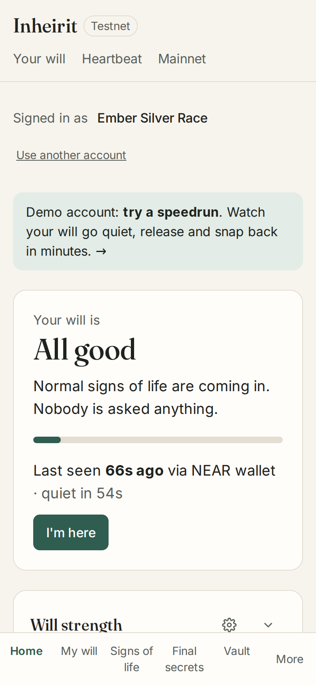
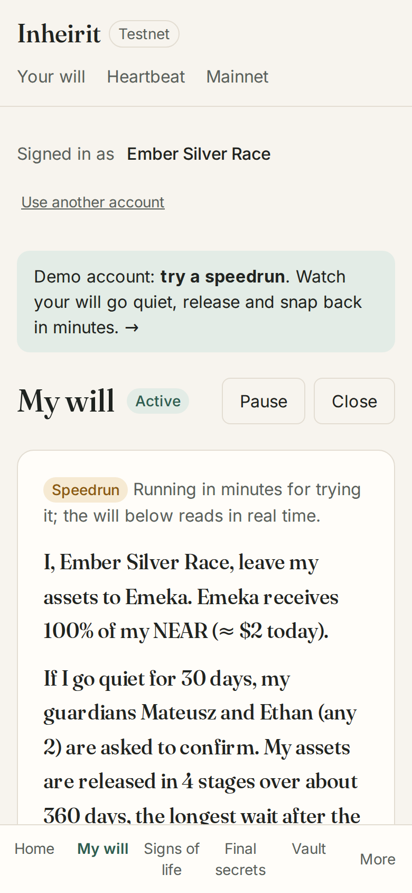
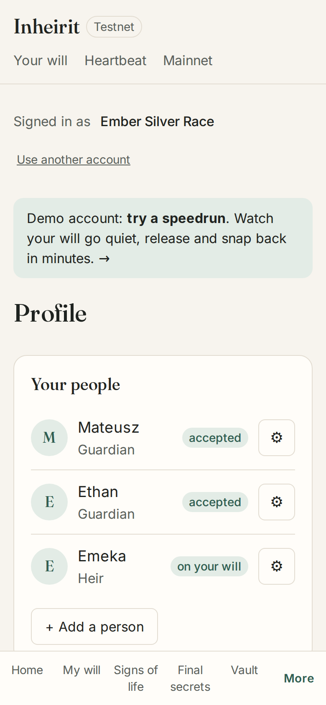
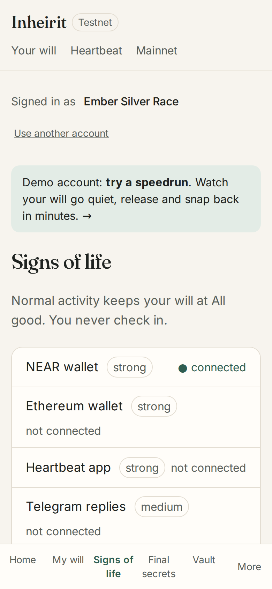
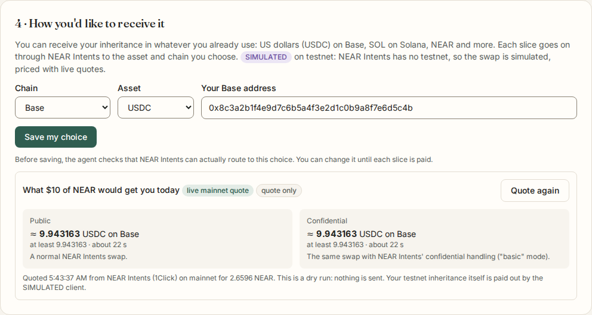

# Inheirit — a will that doesn't make you prove you're alive

Built at **NEAR HACKATHON** (November 2026).

**Testnet: fully self-serve. Mainnet: live NEAR Intents quotes, and two real payouts already made (public Base → Solana, confidential Base → Arbitrum), signed by Chain Signatures and approved by a person one transaction at a time. Public mainnet vaults wait for a production TEE framework and an audit.**

Inheirit notices the signs of life you already give off, privately, and only reaches out when you've gone quiet for longer than usual. It **never acts on silence alone**: people have to confirm you're gone, and you get a loud challenge period to say otherwise. Only then does it hand your assets on across **NEAR, Ethereum and Bitcoin**, in small, reversible slices. Sealed instructions for everything else reach the right heir **last**.

**Try it:** https://inheirit.xyz · Live mainnet quotes: https://inheirit.xyz/mainnet · Agent (TEE): https://d5b714731becca502b6bd054a5cf6ffa5ce71f61-3000.dstack-pha-prod9.phala.network · Contract: [`inheirit.testnet`](https://testnet.nearblocks.io/address/inheirit.testnet)

<p align="center">
  
  <br><sub>Recorded on the live stack (testnet + the TEE agent): about 4 minutes of silence, sped up, then one heartbeat.</sub>
</p>

<p>
  
  
  
  
  
</p>

<sub>Home and My will from the app against the live testnet backend; the heir's quotes from an earlier run. More in <a href="docs/screenshots">docs/screenshots</a>.</sub>

## For judges, in one minute

| What to check | Where |
|---|---|
| The core moment: silence climbs the ladder, one sign of life snaps it back | [Try it in 3 minutes](#try-it-in-3-minutes-no-wallet-no-money) on the live app |
| Real cross-chain execution: NEAR, Ethereum (Sepolia) and Bitcoin (testnet4) released in stages, with explorer links | [Then the full run](#then-the-full-run-about-15-minutes) |
| An attested TEE agent and private AI, verifiable on-chain | `npx tsx scripts/verify.ts`: one read-only command, PASS/FAIL per check (explained in [`docs/VERIFY.md`](docs/VERIFY.md)); the trust badges under *Signs of life*; [`deploy/tee-agent.json`](deploy/tee-agent.json) lists every deployed compose hash |
| NEAR Intents on mainnet | two real payouts (public Base → Solana, confidential Base → Arbitrum) with explorer links on [`/mainnet`](https://inheirit.xyz/mainnet); live quotes on the heir page |
| Tests and security work | 260 agent tests, 193 contract unit tests plus sandbox flows, run on every push ([CI](.github/workflows/ci.yml)); five adversarial review rounds logged finding by finding in [`CLAUDE.md`](CLAUDE.md) (Decision log) and summarised in [`docs/AUDITS.md`](docs/AUDITS.md) |
| What's real and what's simulated | [Real vs simulated](#real-vs-simulated) |

### Real vs simulated

| Real | Not real yet |
|---|---|
| The will contract, guardians, challenge period and staged release on NEAR testnet | Social and work signals (Google, X, Instagram, TikTok, Facebook, LinkedIn): listed as *coming soon* with their weights; the control panel can send a SIMULATED one to show how weak signals are handled |
| NEAR, Sepolia ETH and testnet4 BTC payouts, signed by Chain Signatures (MPC) | DM check messages |
| The agent in an Intel TDX enclave on Phala, attested on-chain | The onward NEAR Intents swap on testnet (NEAR Intents has no testnet; priced with live quotes) |
| Signs of life: transactions from your NEAR accounts (testnet, and mainnet `.near` read-only) and Sepolia addresses, the signed heartbeat, Telegram replies, GitHub | |
| Email checks and alerts, sent from `mail.inheirit.xyz` to addresses you enter (*Email alerts*): your check-ins, welfare questions, guardian vote requests, the challenge alarm. Only the time is kept, never the content | |
| Sealed notes encrypted in the browser, re-sealed inside the enclave | |
| Plain-English drafting and the heir guide on an attested NEAR AI Cloud model | |
| Live NEAR Intents quotes from mainnet, public and confidential | |

## Four ideas the design rests on

1. **Passive liveness is safe only because of an asymmetry.** Signals can stop the will. Only people can start it: a quorum of guardians who accepted the role, then a challenge period.
2. **The first release is the loudest alarm.** A 10% slice leaving your vaults, with heirs notified, is when a living owner notices. So the *longest wait* comes right after the first slice, and a false trigger costs at most that slice.
3. **Secrets come last.** Funds move in slices, but a revealed secret can never be taken back. Sealed notes are released only after distribution completes, plus one more wait.
4. **Private by construction.** The agent reads signals inside a TEE and only timestamps leave it. In-product AI uses only an attested NEAR AI Cloud model.

**People don't need a NEAR account.** The owner makes a one-time link for a guardian, friend or lawyer (*Invite someone by link*); the person opens it, signs in with Google, and accepts. The contract keeps only a hash of the code, and the link carries it in its `#fragment`, so it never reaches a server.

**The zero-custody way in: a notes-only will.** You don't have to put money in a vault. Tick *Notes only, no vaults* and the will holds nothing but sealed notes: where the hardware wallet is, which exchanges you use, who holds the passphrase. The same ladder runs (guardians, challenge period, the long wait), and the notes are released last, per heir. Your assets never leave your wallets; your heirs just learn how to reach them. Heirs can press *Test my key* any time to prove their key opens notes, without revealing any. Templates and a split-your-secret tip are in the *Final secrets* step.

**Your heirs receive what they actually use.** Each heir chooses the asset and chain they're paid in (USDC on Base, SOL on Solana, NEAR…), and every released slice goes on to them through **NEAR Intents**. Owners can choose **stable value**, so each slice is converted to US dollars as it's released and heirs aren't exposed to price swings during a release that takes months. A will can also be **funded from anywhere**, from whatever token and chain the owner holds.

Inactivity-based tools exist, such as Google Inactive Account Manager and Bitcoin timelock wallets. What's new is the combination: many weighted sources read privately in a TEE, a human escalation ladder before anything moves, staged cross-chain execution, and secrets last.

## The problem

Billions in crypto are lost when holders die or become incapacitated. Earlier attempts mostly solved the *transfer* and failed on the *humans*:

| Problem | Why past attempts failed | What Inheirit does |
|---|---|---|
| Check-in fatigue | Dead-man's switches make you prove you're alive every month. People forget. | No check-ins. The agent notices activity you already produce, and asks (heartbeat app, Telegram) only when you've gone quiet. |
| False triggers | A hospital stay, a retreat or a lost phone looks like death to a timer. | Silence alone can never execute. It takes a guardian quorum, then a challenge period that any sign of life cancels. |
| Single chain | Bitcoin-only timelocks, EVM-only contracts. | One will across NEAR, Ethereum (Sepolia) and Bitcoin (testnet4) via NEAR Chain Signatures. |
| Heirs can't claim | Heirs don't know the assets exist, or don't have the right wallet for the right chain. | A guided claim page, an AI guide that sees only the heir's own details, and payouts in whatever asset and chain the heir already uses (NEAR Intents). |
| Secrets in a public will | A seed phrase can't go into a will that becomes public. | Sealed notes, encrypted in the browser to a TEE key and re-sealed to the heir only after distribution completes. |
| No undo | Once triggered, everything moves at once. | 10% → 20% → 30% → 40%, with the longest wait after the first slice. Any sign of life stops the rest, and the secrets. |

## Try it in 3 minutes (no wallet, no money)

Everything runs on testnet. One path, start to finish:

1. Open **https://inheirit.xyz/account** and click **Try with a demo account**. You get a fresh, funded testnet account whose key stays in your browser. A NEAR testnet wallet or Google sign-in works too.
   → **Set up your account**: a username (made up for you, editable), *Save your recovery key*, your people (a name is enough) and your vault (a name and its chains). Every step can be skipped; all of it lives in **Profile** later.
2. On **Home**, the will form: tap ↻ next to the heir and twice next to the guardians (funded test people with new names each time). **Speedrun** is on: minutes instead of months, for trying it. Add a final secret if you like, then **Start my will** (**Save as draft** keeps it off-chain instead).
   → **Home** shows the will at **All good**, when it last saw you, **I'm here**, the **Will strength** bar and one next step. **My will** reads like a will, in real timings, with a *Speedrun* badge.
3. Click the banner **Demo account: try a speedrun**. The card is on scenario **a · The owner comes back** (quiet after 2 minutes instead of 30 days). Do nothing for about 2 minutes.
   → The ladder climbs to **Quiet** and then **Welfare check**; the checks are listed under **Activity** (heartbeat app, email if you added one, Telegram if linked, a SIMULATED DM).
4. Click **I'm here (send a heartbeat)**.
   → Within seconds the ladder **snaps back to All good**, and the verdict says nothing moved. That's the whole idea: signals can stop it; only people can start it.

In a hurry? On the speedrun page, **Generate my will** makes a complete will with a full cast, funded vaults and a sealed note in one click.

## Then the full run (about 15 minutes)

On **Try a speedrun**, pick another scenario. The card shows a checklist with a button for each step you take.
- **b · The will is carried out.** Click **Create &lt;heir&gt;'s key** (buttons use the heir's generated name), wait for **Guardian vote** (about 4 minutes), then **Both guardians confirm**. → **Challenge period** (2 minutes), then **Releasing in stages**: 10% lands on NEAR, Sepolia and BTC testnet4, with explorer links under **Vault** → *Released so far*. The next slice waits **3 minutes**, the longest wait; then 20%, 30%, 40% a minute apart; then **Waiting before secrets**, then **Secrets released**. Click **Open &lt;heir&gt;'s view** → **Open the note**: *"The Ledger is in the blue folder in the study…"*, sealed in your browser and opened only with the heir's key.
- **c · A lawyer speeds it up.** Once the guardian vote has started, click **File the death certificate** (the evidence is SIMULATED), then **Both guardians confirm**. → The challenge period still runs in full; the release then follows the faster 10% → 30% → 60% schedule.
- **d · The heir chooses late.** Don't set the heir's payout. → After the release starts, **Vault** → *Payouts to heirs* shows slices waiting for the heir to choose. Open the heir's view, choose e.g. **USDC on Base** with an address, and **Save my choice** → the waiting slices pay out together (SIMULATED NEAR Intents on testnet, priced live).

**View as** (on the same card) opens the guardian, heir, friend and lawyer pages as those accounts; each links back to the speedrun. On the heir's page, once an address is entered, **Get live quotes** shows real NEAR Intents quotes from mainnet, public and confidential side by side (dry runs: no money moves; the confidential column needs our partner key on the deployment). The same quote is on **https://inheirit.xyz/mainnet**. Afterwards: **Back to real timings**, or, once Completed, **Start over with the same people**.

**At any step, try to break the rule "signals stop it, people start it":** on the [control panel](https://inheirit.xyz/demo), a lone **X post** (SIMULATED) is ignored on purpose, and the verdict says why (*"ignored on its own because posts can be scheduled or run by someone else"*). Two weak sources within 24 hours, or any strong one, do count. A will whose guardians haven't accepted never leaves All good, however long the silence.

**Advanced:** the [control panel](https://inheirit.xyz/demo) (`/demo`) is a lower-level control room for the same flow: **Make a test cast**, **Create the demo will**, then the guardian and signal buttons. The same steps run headlessly in `scripts/demo-cancel.ts` (cancel) and `scripts/demo-execute.ts` (release).

**Your own will** (`/account`): one screen per job. **Home** (where the will stands, I'm here, strength, the next step) · **My will** (a status pill, *Draft*, *Active*, *Paused until …* or *Completed*, with **Pause** (1 to 90 days; it resumes by itself, with reminders 7 days and 1 day before), **Resume** and **Close**; the will in plain sentences; then heirs, guardians (with a − n + stepper for how many must confirm), lawyer and friends, each edited in place with ⚙; the schedule) · **Signs of life** (one ranked list; the quiet period, which we suggest from your history and you choose) · **Final secrets** · **Vault** (holdings, withdrawals, also while paused, fund from another chain, payouts) · **Activity** (messages and the timeline; hashes and attestation under *Technical details*) · **Profile** (your people as rows, each with ⚙ for name, role, email, Telegram and wallets, saved with the agent and never on-chain; the vault's name; username, recovery key, alerts, sign out). Invite links look like `https://inheirit.xyz/i/<code>`: no owner or names in the URL. Questions people ask first are on [`/faq`](https://inheirit.xyz/faq). On a phone the first five sit in a bottom bar. The will can also be written **in plain English** (a private NEAR AI model drafts it, our code checks it and asks only for what's missing; you approve a summary that code, not the model, wrote). Lost your browser? **Restore from backup** or **Use an account from another device** on the sign-in screen. `/heartbeat` is an installable app.

## How it works

```
 signals (NEAR txs · Sepolia txs · heartbeat app · Telegram replies · GitHub ·
          SIMULATED: calendar, mail, X, Instagram, TikTok, Facebook, LinkedIn)
        │  timestamps only
        ▼
 ┌──────────────────────────────┐ record_liveness / advance ┌──────────────────────────────┐
 │ Will agent (Shade Agent,     │──────────────────────────▶│ inheirit.testnet (Rust)      │
 │ Intel TDX on Phala)          │                           │ will state machine, guardians│
 │ scoring · verdict · checks · │◀── gated request_signature│ NEAR vault, signing gate     │
 │ executor · sealed notes      │                           └───────────┬──────────────────┘
 └──────┬───────────────┬───────┘                                       │ sign (only while Executing,
        │               │ NEAR AI Cloud (attested TEE model)            ▼  or an owner withdrawal)
        │               └─ plain-English will → policy; heir guide   MPC signer v1.signer-prod.testnet
        ├──▶ Sepolia · BTC testnet4 (signed vault transfers)
        ├──▶ NEAR Intents 1Click (SIMULATED on testnet; live prices)
        └──▶ Telegram bot (check messages; replies count as signs of life)

 web (Next.js on Vercel): owner, guardian, lawyer, friend and heir pages · sign-in (wallet, Google, demo)
                          · /api/onboard (creates testnet accounts from browser-made public keys)
                          · /api/quote (live mainnet 1Click dry quotes, public and confidential)
```

**The ladder:**
1. **All good** (armed only once enough guardians accept).
2. **Quiet:** after silence longer than your usual. At setup the app reads your own NEAR (and Sepolia) history, finds your typical gap between transactions, and suggests 3× it (at least 30 days); you choose the number. The verdict then says "quiet 9 days (usually active every 3 days)". Checks go out to the heartbeat app, email, Telegram, then DMs.
3. **Welfare check** (14 days): guardians, friends and the lawyer are asked whether they've heard from you.
4. **Guardian vote** (30 days): one "they're alive" stops it.
5. **Challenge period** (60 days): you're alerted everywhere.
6. **Releasing in stages:** 10% → *6 months, the longest wait* → 20% → 3 months → 30% → 3 months → 40%.
7. **Waiting before secrets** (3 months).
8. **Secrets released.**
9. **Completed.**

**Signals vs checks.**
- A strong signal (a signed NEAR or Sepolia transaction, a heartbeat) or a medium one (a Telegram reply) counts on its own.
- A weak signal (a social post, GitHub) counts only if a second, different source agrees within 24 hours.
- Any counted sign of life sends the will back to the top, even mid-release or while waiting before secrets.

These are the real defaults; every number is the owner's to change, and the speedrun runs the same ladder in minutes. A will shouldn't panic; the accelerated path covers urgent needs like funeral costs.

**Acceleration.** A lawyer, or the guardian quorum with evidence, can attest a death certificate. That switches the remaining stages to a faster schedule (10/30/60, 14 days apart). It never skips the guardian vote, the challenge period or a stage.

## NEAR Intents on mainnet

On testnet the onward swap to each heir runs on a SIMULATED 1Click client, because NEAR Intents has no testnet. On mainnet:
- heirs see **live quotes**, public and confidential side by side, for the asset and chain they choose (`/api/quote`, dry runs);
- **real payouts** go out from a demo vault on Base, a Chain Signatures address derived from a NEAR mainnet account and signed by the MPC network, through `scripts/mainnet-payout.ts`, which a person approves one transaction at a time (caps: $5 each, $25 in total). Two are done (2026-11-12), both 1.90 USDC from the vault:
  - public, to USDC on Solana: [MPC signature](https://nearblocks.io/txns/FWPUnhyCSJrCHqzJBahCazgeLmURHGVPSsHdWtxdXcYH) · [sent on Base](https://basescan.org/tx/0xb70144f0f8ec0e99ab98c168a1925d2b69476d57aa1c2d59a1f306fe1a099c18) · [received on Solana](https://solscan.io/tx/65BJcb63tQkQnQ57Nsopv1v6cZKppy2GmnLmqiYJ2bCAsg9XYL1VuKyPyokGdzRyrw4kaDisvYvzhb8sbuRzpSaU);
  - confidential (Confidential Intents, `basic`), to USDC on Arbitrum: [MPC signature](https://nearblocks.io/txns/4RW7R4CsXYpYWaumCfT7DDCGs89Ph7faiJ797ypn8dDB) · [sent on Base](https://basescan.org/tx/0x2716595c73b267af1c03a87d737e24fdea4960274a99972af31209ca6b8f8790) · [received on Arbitrum](https://arbiscan.io/tx/0x448b42caa4165351684f87dede862c10d493aa36c5a01e50670e8e9e1d73e3d6).

  They are sends from the demo vault, not slices of a testnet will (Intents has no testnet), and both recipient addresses are the builder's own wallets. Both are listed on [`/mainnet`](https://inheirit.xyz/mainnet);
- the step-by-step, including a read-only `preflight` check, is [`docs/MAINNET.md`](docs/MAINNET.md).

## NEAR technology used, and where

| Tech | Used for | Code |
|---|---|---|
| NEAR smart contract (Rust, near-sdk 5) | Will state machine (stage waits, secrets buffer, guardian consent, lawyer acceleration, Start over, one-time invite links), NEAR vault, signing gate, sealed-note storage, NEP-297 events | `agent-contract/src/will/` (173 unit tests, sandbox tests in `agent-contract/tests/will_flow_tests.rs`) |
| **Chain Signatures** (`v1.signer-prod.testnet`) | Vault addresses on Sepolia and BTC testnet4, derived from the contract account (`heirloom/<owner>/eth\|btc`); release and withdrawal signatures | gate: `agent-contract/src/will/agent.rs`; tx building: `src/chains/evm.ts`, `src/chains/btc.ts` (chainsig.js) |
| **Shade Agent Framework** (TEE on Phala) | The will agent: liveness scoring and verdict, escalation and checks, execution, sealed-note crypto, Telegram bot. Registered with a real TDX attestation; measurements approved on-chain. | `src/index.ts`, `src/escalation/`, `src/liveness/`, `src/executor/`, `src/sealed/`, `src/telegram/`, `scripts/tee-agent.ts` |
| **NEAR AI Cloud** (private inference) | Plain-English will → structured policy; heir claim guide. Will text goes only to a model whose attestation passes (TDX quote, NVIDIA GPU, signer bound to a fresh nonce; checked at startup and before each use), and every answer's signature must recover to the attested signer. | `src/ai/attestation.ts`, `src/ai/nearai.ts`, `src/ai/policy-parser.ts`, `src/ai/heir-guide.ts` |
| **NEAR Intents** (1Click API) | Universal payout: each released slice goes on to the heir's chosen asset and chain; stable value (USDC); fund from anywhere. On testnet the agent uses a SIMULATED 1Click client with live prices. Heirs see live mainnet dry quotes, public and confidential. Two real mainnet payouts (public and confidential) were sent from a Chain Signatures-derived Base vault, through an approval-gated script (listed on `/mainnet`). | `src/intents/oneclick.ts`, `src/intents/payout.ts`, `web/src/app/api/quote/route.ts`, `web/src/components/Payouts.tsx`, `web/src/app/mainnet/page.tsx`, `scripts/mainnet-payout.ts` |
| NEAR Wallet Selector + named accounts | Sign in with MyNearWallet, Meteor or Intear; Google and demo users get `<id>.inheirit-users.testnet` accounts whose key is generated in their browser | `web/src/lib/wallet.ts`, `web/src/lib/onboard.ts`, `web/src/app/api/onboard/route.ts` |
| NEP-413 signed messages | Owner-signed requests to the agent (heartbeat, watch settings, Telegram link, drafting, guide, demo faucet), and heir-signed payout choices, checked against the account's on-chain keys | `src/auth/nep413.ts`, `web/src/lib/near.ts`, `web/src/lib/wallet.ts` |

## Why NEAR

A will has to outlive its owner's devices, and Inheirit needs four things that are rare to find on one chain:
- **One account that signs on every chain.** Chain Signatures let a single NEAR contract hold and release ETH and BTC, with no bridges and no keys for anyone to lose.
- **An agent you don't have to trust.** Shade Agents run the liveness logic in a TEE and register with an attestation the contract checks, so the code that can move money is the code that was approved.
- **Private AI.** NEAR AI Cloud serves attested models, so the wording of a will can be drafted with AI without becoming training data or a leak.
- **Payouts in what heirs use.** NEAR Intents turns a release into whatever asset and chain each heir wants, which is the difference between an heir being paid and an heir being stuck.

Named accounts and function-call keys make the human side workable: readable names for guardians and heirs, and limited keys for a heartbeat device.

## Sustainability: who pays, and why it lasts

- **The product:** a will people set up once and forget, priced like insurance: a small yearly fee per will (covering the agent's gas, hosting and AI), free to set up.
- **A fee on the release, not the savings:** a small percentage of each slice when it's paid out through NEAR Intents (the 1Click partner fee), so the service earns when it actually delivers, and nothing while the owner is alive.
- **Professionals:** estate lawyers and family offices manage wills for clients; the lawyer role and death-certificate path are already built for them.
- **Beyond wills:** the same engine (conditions attested by people, a challenge window, staged release) fits conditional gifts and trusts; see the roadmap.
- **Running costs today:** about $0.06 an hour for the TEE and a few NEAR a month in gas; per-will budgets stop any one will from running costs up.

## Privacy

- **What runs in the TEE:** the agent. It polls signal sources, scores liveness, signs releases, runs the Telegram bot, and holds the sealed-notes private key. That key is derived from Phala's KMS for this app (`getKey`) and kept only in memory.
- **What leaves it:** timestamps (`record_liveness`), state transitions, signed transfers, and notes re-sealed to an heir's key. Signal adapters return the time of the latest activity, never content. A Telegram reply is recorded as its receive time only; its text is never stored or logged.
- **Sealed notes:** encrypted in the owner's browser (libsodium sealed box) to the agent's key, sealed together with the owner and heir they were written for; only ciphertext goes on-chain, and the agent releases a note only inside that will and only to that heir. Once the will reaches *Secrets released*, the agent opens each note inside the TEE and re-seals it to the heir's X25519 key, and the heir decrypts it in their browser.
- **Will text** is processed only by an attested NEAR AI Cloud model. When we checked (2026-10-27), only 12 of 61 listed models returned an attestation; the agent refuses any model that doesn't.
- **Minimal data:** sign-up asks for a display name and, optionally, a jurisdiction. Nothing else: no date of birth, nationality or photo. Google sign-in names the account after a hash of Google's user id; the email never goes on-chain, and we never hold the account's key.
- **In the UI:** the *Signs of life* panel says "What the agent saw: timestamps only", next to badges for the attested TEE agent (approved compose hashes, registered agent, sealed-notes key match) and for the NEAR AI model (each check of a fresh attestation).

## Threat model

See [`docs/THREAT_MODEL.md`](docs/THREAT_MODEL.md). In short:
- A greedy heir needs colluding *accepted* guardians *and* the owner's silence through a loud challenge period. Even then, a false trigger costs at most the first 10% before the long wait.
- A lawyer colluding with an heir can only shorten the waits, never skip a step.
- Outsiders can't move vault funds: only the attested agent can request signatures, and only while a will is executing.
- The developer can't read notes without shipping new agent code, which shows up as a new compose hash (with the caveat about Phala's centralized KMS below).
- Several adversarial passes, an independent audit and five review rounds are summarised in [`docs/AUDITS.md`](docs/AUDITS.md) and recorded finding by finding in `CLAUDE.md` (Decision log, 2026-11-06 to 2026-11-11, including a critical sealed-note fix). Each security fix has a test.

## Honest limitations

- **Experimental stack.** The Shade Agent Framework is unaudited and testnet-only. The will runs on NEAR testnet, Sepolia and BTC testnet4.
- **Vault model.** Assets must be moved into vaults the will controls: the NEAR vault in the contract, and Sepolia/BTC addresses derived by Chain Signatures. The owner can withdraw while the will is at All good or paused.
- **Signals not connected yet:** Google Calendar, Gmail, X, Instagram, TikTok, Facebook, LinkedIn are listed as *coming soon* (the control panel can send a SIMULATED one, labelled so). Real: transactions from your NEAR accounts (testnet, and mainnet `.near` read-only) and Sepolia addresses, the signed heartbeat, Telegram replies, GitHub.
- **Email limits.** On the free sending tier (about 100 a day), demo-timing wills get one email per address per run from a smaller daily budget, so real-timing wills keep room; when a limit is reached, the message stays in the app with a note. Replies to these emails aren't read: the email says to open the heartbeat app or reply on Telegram.
- **Heirs are hidden in the UI only.** The app and agent don't reveal heirs before the release, but heir accounts and NEAR shares are in contract state, which anyone can read. Commit-reveal is on the roadmap.
- **Payload-blind gate.** The contract decides *when* and *which vault* can be signed, not *what* the transaction says. That rests on the attested agent code and a per-stage signature cap.
- **Centralized KMS.** With Phala's KMS, whoever controls the Phala account could push new agent code that derives the same sealed-notes key. Every deployed compose hash is published (`deploy/tee-agent.json`) and must be approved on the contract to register. An on-chain KMS with a timelocked allowlist is on the roadmap.
- **Key persistence.** The sealed-notes key is tied to one Phala app; the agent is upgraded in place and never re-created. Losing that app means owners must re-seal their notes.
- **Not built yet:**
  - `not_before` conditions are parsed and shown today; enforcement is next;
  - a quiet period that keeps adapting: it is suggested from your history at setup, then stays the number you confirmed.
- **Expired guardian votes restart the ladder.** If guardians don't vote, the will returns to All good without a new sign of life, so the ladder starts again at once (about every 7 minutes on demo timings). The repeated checks and welfare messages appear in the app, but Telegram sends each of them only once per silence. The challenge alarm is always sent.
- **NEAR Intents is SIMULATED on testnet.** NEAR Intents has no testnet. The testnet slices are real transfers; the swap that takes them on to the heir's choice runs on a simulated 1Click client (live prices, fake deposit address). On mainnet: heirs see live dry quotes, and real payouts were sent from our demo vault (see above) only by a local script (`scripts/mainnet-payout.ts`) that asks a person for approval before every transaction (caps: $5 each, $25 in total). Any made are listed at `/mainnet`. In production, the attested agent's mainnet contract would sign these legs.
- **Payout waiting happens after the vault.** If an heir hasn't chosen how to be paid, their onward payout waits and later slices are paid together. The testnet slice itself still leaves the vault on schedule. Holding it in the vault would need a contract change (roadmap).
- **One will and one vault per account.** Several vaults with their own rules are on the roadmap.
- **Contact details stay off-chain.** People's email, Telegram and wallets are saved with the agent, owner-signed, inside the enclave; a person on the will can't be deleted from Profile until they're removed from the will.
- **Closing a will.** The contract can't see other chains; the app checks the Sepolia and Bitcoin vaults (through the agent) before it offers *Close will*.
- **Extra signal sources are private.** The agent never reveals the extra NEAR accounts or Sepolia addresses you added, so they can be removed only from the device you added them on.
- **Names are local.** Usernames and the generated people's names live in your browser; the testnet account id stays the on-chain identity, and other browsers see the account id.
- **Browser-held keys.** Demo and Google accounts keep their key in the browser that made them, so a Google account works in that browser only, and a lost browser means a lost testnet account. Wallet users keep their keys in their wallet.
- **Speedruns expire.** On the hosted demo, the agent stops watching a will on demo timings a few hours after it started (never mid-release, in the guardian vote or in the challenge period). Wills on real timings are watched indefinitely.
- **Start over clears the old record.** Replacing a Completed will keeps released notes and leftover NEAR, but drops the old will's execution records, so onward payouts still waiting for an heir's choice from that run are dropped too.

## Roadmap

- **Several vaults with their own rules (conditional gifts).** One account, several vaults, each with its own people, conditions and schedule.
- **Beyond wills: conditional gifts.** The will is the first product of a conditional-release engine: time or milestone conditions, attested by people, with a challenge window and staged release. The `not_before` condition is the first example: parsed and shown today; enforcement is next. Milestones and dates only; never conditions on relationships, beliefs or lifestyle.
- A human adjudicator for disputes and heir support.
- Real wallet and email linking for Google Calendar, Gmail, X, Instagram and LinkedIn, with OAuth tokens kept in the TEE.
- A quiet period that adapts over time, per source.
- Incapacity mode: a capped caretaker allowance via function-call keys.
- Fire-drill mode, and stale-will review.
- A lawyer companion letter.
- Gasless heir claims.
- Real-world contacts: guardians, friends and lawyers reached by phone number instead of a link, and bank or Cash App payouts for heirs without crypto.
- **Private inheritance with Confidential Intents:** payouts that observers can't trace from the will's release to the heir's receipt. A confidential payout has already gone through on mainnet (above); heirs see confidential quotes next to public ones.
- **Intents-native vault:** the will holds every asset as a NEAR Intents balance, distributes by internal transfer, and heirs withdraw to any chain. One vault for every asset, and instant cross-chain payout. A dry 1Click quote from an Intents balance to USDC on Base already succeeds.
- Self-funding upkeep: the agent pays its own inference and hosting via Intents, and tops up gas for vaults and heirs.
- Contract-level heir hiding (commit-reveal).
- An on-chain KMS with a timelocked compose allowlist.

## Run it yourself

The quickest way: run the web app against the hosted backend (the attested agent and `inheirit.testnet`), which is what `web/.env.example` points at.

```bash
npm ci --ignore-scripts                 # repo root (the web app imports the shared policy code)
cd web && npm ci && cp .env.example .env.local && npm run dev -- -p 3100   # web on :3100
```

Sign-in and live quotes also need the server-side variables listed in `web/.env.example` (a testnet account to fund sign-ups, and the 1Click key); without them those parts say they aren't available.

The agent and its tests:

```bash
npm ci                                  # repo root
npm test                                # agent tests (260)
cp .env.example .env                    # AGENT_CONTRACT_ID, SPONSOR_*, NEARAI_API_KEY, DEMO_MODE=true (TELEGRAM_* optional)
npm run dev                             # agent on :3000
```

A local agent can't register on `inheirit.testnet`, which accepts only the attested TEE agent. Give it its own local-mode contract (`npx tsx scripts/deploy-dev-contract.ts <your agent's account id>` creates it and whitelists that agent) and point both `.env` files at it.

Contract: `cd agent-contract && cargo +1.86.0 test --lib` (193 unit tests). The sandbox tests (`cargo +1.86.0 test --tests`) need the wasm at `target/near/shade_contract_template.wasm` first: `cargo +1.86.0 near build non-reproducible-wasm --no-abi` (or the pinned `sourcescan/cargo-near` Docker image).

Headless scenario scripts:
- `scripts/demo-cancel.ts`: Scenario A.
- `scripts/demo-execute.ts`: Scenario B on three chains.
- `scripts/demo-sealed-note.ts`: English will → sealed note → heir decrypts, secrets last.
- `scripts/demo-accelerate.ts`: lawyer death proof → accelerated schedule; the challenge period is kept.
- `scripts/demo-telegram.ts`: an unarmed will stays at All good; a Telegram reply cancels Quiet.
- `scripts/demo-payout.ts`: Scenario B with NEAR Intents payouts (SIMULATED): two heirs, stable value, one heir choosing late.
- `scripts/load-test.ts`: many concurrent speedrun wills against one agent.
- `scripts/mainnet-payout.ts`: the **mainnet** NEAR Intents demo (vault address, dry quotes, approval-gated payouts and funding; caps $5 per transaction, $25 in total).

Helpers: `scripts/fund-vaults.ts`, `scripts/new-funder.ts`. Deploying: [`docs/DEPLOY.md`](docs/DEPLOY.md). The project brief and every decision with its evidence: [`CLAUDE.md`](CLAUDE.md).

## Credits

- Built on the [Shade Agent template](https://github.com/NearDeFi/shade-agent-template) by NEAR (Apache-2.0); see `LICENSE`, `NOTICE.txt`, `LICENSE-THIRD-PARTY.txt`.
- NEAR AI attestation checks adapted from [nearai/nearai-cloud-verifier](https://github.com/nearai/nearai-cloud-verifier) (MIT, `src/ai/LICENSE-nearai-cloud-verifier`).
- Built with Claude Code.
